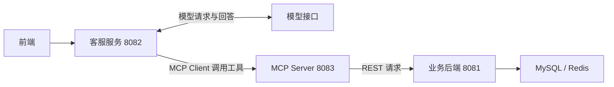
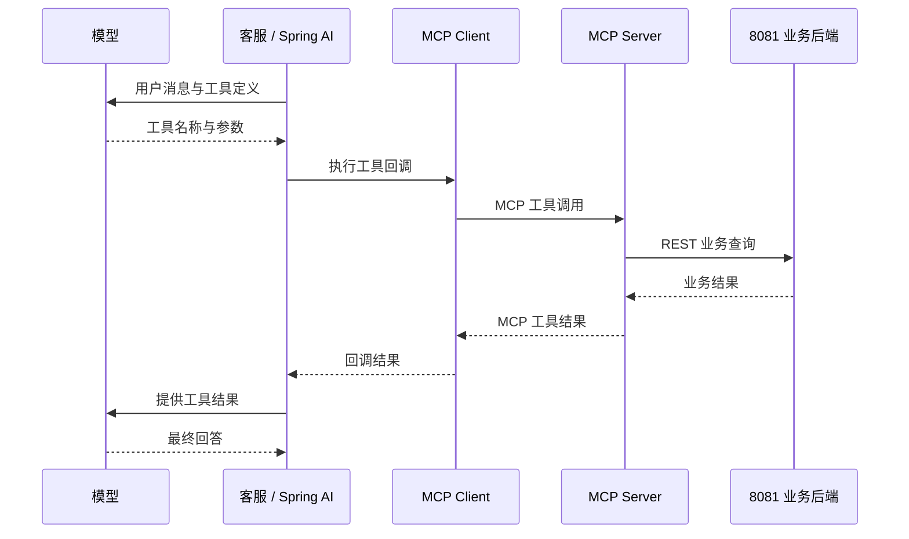
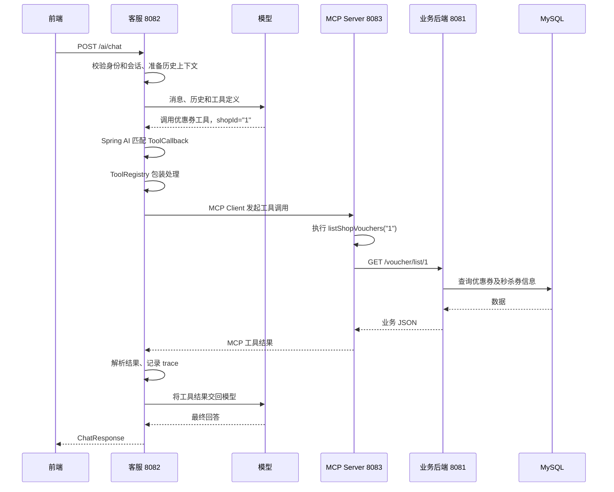

# LifePulse 智能客服模块学习笔记

> 学习时按模型已成功接入的完整链路理解设计。实际验证边界：真实模型接入代码已存在，中转平台调用和真实模型工具选择尚未验证成功；不能将设计链路描述为已验证结果。

## 第一部分：模块划分与整体架构

### 1. 三个模块的职责

客服负责理解问题和组织对话，业务后端提供业务事实，MCP Server 将业务能力包装成工具。

| 模块 | 端口 | 技术栈 | 主要职责 |
|---|---:|---|---|
| 原业务后端 | 8081 | Spring Boot 2.7.4、Java 8 编译目标、MySQL、Redis | 登录、商户、优惠券、订单、数据访问及业务权限 |
| ai-customer-service | 8082 | Java 17、Spring Boot 3.5.11、Spring AI 1.1.8 | 接收聊天请求、管理会话、请求模型、执行工具回调 |
| business-mcp-server | 8083 | Java 17、Spring Boot 3.5.11、Spring AI 1.1.8 | 发布只读业务工具，通过 REST 调用原业务后端 |

三个模块是独立 Spring Boot 应用，可以在同一台机器运行三个进程。Java 8 是原后端的编译目标，不代表已核实其运行 JVM 版本。



模型不直接访问数据库。它提出工具调用请求，由应用执行；业务数据来自原后端。携带登录 token 时，客服还会直接请求业务后端 `/user/me` 校验身份，这一步不经过 MCP。

### 2. 为什么将客服独立部署

代码依据：根目录 `pom.xml` 使用 Boot 2.7.4，编译 source/target 为 8；`ai-customer-service/pom.xml` 使用 Boot 3.5.11、Java 17、Spring AI 1.1.8。

```xml
<!-- 原后端 pom.xml 的相关配置 -->
<version>2.7.4</version> <!-- Spring Boot parent -->
<maven.compiler.source>8</maven.compiler.source>
<maven.compiler.target>8</maven.compiler.target>

<!-- ai-customer-service/pom.xml 的相关配置 -->
<version>3.5.11</version> <!-- Spring Boot parent -->
<java.version>17</java.version>
<spring-ai.version>1.1.8</spring-ai.version>
```

原后端使用 `javax.servlet`，客服使用 `jakarta.servlet`。将当前客服代码直接放进原项目，需要解决 Java、Spring 依赖和 Servlet API 的兼容与迁移问题。独立部署让新模块使用自己的依赖体系，通过 HTTP 复用原业务。

模型配置、提示词和 AI 依赖可以随客服服务单独发布；代价是增加进程、网络调用、启动顺序和故障排查工作。这些是根据代码结构推导出的设计价值，不代表仓库记录了所有原始设计决策，也不意味着所有 AI 客服都必须拆服务。

独立进程不等于完全隔离故障：工具查询仍依赖 8083 和 8081。当前会话保存在内存，也不能直接声称已支持多实例共享会话。

### 3. 为什么独立设置 MCP Server

8082 负责对话，例如理解“第一家有什么优惠券”；8083 提供明确的业务能力，例如 `listShopVouchers(shopId)`。

代码位置：`business-mcp-server/src/main/java/com/hmdp/mcp/BusinessTools.java`。

```java
@Bean
ToolCallbackProvider businessToolProvider() {
    return MethodToolCallbackProvider.builder()
            .toolObjects(this)
            .build();
}
```

这段代码将当前对象上的工具方法注册成 Spring AI 工具回调，供 MCP Server 发布。

```java
@Tool(description = "查询指定商户的优惠券，payValue和actualValue单位为分，展示时除以100；不要把数据库记录解释为一定可抢购。")
public JsonNode listShopVouchers(
        @ToolParam(description = "商户ID") String shopId) {
    return numeric(shopId)
            ? get("/voucher/list/{id}", "", shopId)
            : failure("商户ID必须为正整数");
}
```

区分三个层次：

- **项目代码**：定义业务工具、校验参数、调用已有 REST 接口。
- **Spring AI 框架**：将方法转换成工具定义和回调，与 MCP Client/Server 集成。
- **MCP 协议**：约定客户端如何发现工具、传入参数和获得结果。

`@Tool` 是框架注解，MCP 是通信协议。项目采用同步 Streamable HTTP，工具服务端口为 8083，端点为 `/mcp`。

独立 MCP 服务为其他 MCP 客户端复用工具提供边界，但当前不能声称已经有多个客户端接入或完成生产级服务认证。

### 4. 一次工具查询如何跨模块执行

以“查询商户 1 的优惠券”为例，在模型正确选择工具的前提下：

1. 8082 接收问题，将消息与工具定义交给模型。
2. 模型返回调用 `listShopVouchers` 的请求，参数为 `shopId="1"`。
3. Spring AI 执行工具回调，通过 MCP Client 请求 8083。
4. 8083 执行 `BusinessTools.listShopVouchers()`。
5. 工具通过 `RestClient` 请求 8081 的 `/voucher/list/1`。
6. 原后端查询数据库，结果沿调用链返回。
7. Spring AI 将工具结果交回模型，模型组织最终回答。

模型负责提出工具调用和组织回答，Java 服务实际执行查询。

`BusinessTools` 使用以下客户端调用业务后端，并未注入原后端的业务 Service 或 Mapper：

```java
rest = RestClient.builder()
        .baseUrl(baseUrl)
        .requestFactory(factory)
        .build();
```

HTTP 接口是两套技术栈之间的边界。原后端继续维护查询逻辑和业务权限，新模块无需复制数据库访问逻辑。

例如 `src/main/java/com/hmdp/controller/VoucherOrderController.java` 中，指定订单查询同时限制订单 ID 和当前登录用户 ID：

```java
.eq("id", id)
.eq("user_id", UserHolder.getUser().getId())
.one();
```

### 5. 其他设计的区别

| 方案 | 收益 | 代价 |
|---|---|---|
| 当前三个服务 | 对话、工具、业务职责清晰，可分别发布 | 网络依赖和部署工作增加 |
| MCP Server 合入客服服务 | 少维护一个进程，仍可保留 MCP 接口 | 工具与客服一起发布 |
| 客服工具直接调用业务 REST | 链路更短，同样可以实现模型工具调用 | 没有独立 MCP 工具服务供其他客户端复用 |
| 全部合入原业务后端 | 可直接调用同进程中的业务方法 | 需要解决技术栈兼容和迁移问题 |

MCP 不是模型调用业务的唯一方式。当前采用它，是为业务工具建立统一的发现和调用边界。MCP 工具内部仍使用 REST，两者承担不同层次的职责。

### 6. 面试口述

> 我把模块分为业务后端、客服服务和 MCP 工具服务。原后端保留 Boot 2.7，负责数据访问和权限；客服使用 Java 17、Boot 3.5 和 Spring AI，负责对话、记忆与模型交互；MCP Server 将已有业务 REST 接口包装成只读工具。这样可以隔离新旧依赖并分别发布，代价是增加网络调用和部署复杂度。模型提出工具调用请求，实际查询和权限判断仍由 Java 服务执行。

实际验证补充：真实模式已写出 ChatClient、工具回调和记忆接入代码，但真实中转平台调用与模型自主选择工具尚未验证成功；当前演示使用规则选择 MCP 工具。

### 7. 递进追问与参考回答

**问：已有 REST 接口，为什么还增加 MCP？**

REST 提供已有业务能力；MCP 将这些能力包装成具有名称、描述和参数 schema 的工具，提供标准化发现与调用方式。模型工具调用也可以直接包装 REST 实现，MCP 的价值是统一工具协议和复用边界，并非只有 MCP 才能调用业务。

**问：把 MCP Server 合入客服服务，是否还能使用 MCP？**

可以。MCP 是协议，不要求服务端必须独占一个进程。合并后仍可发布 MCP 端点，但会共享部署、资源和故障生命周期。当前拆分是架构选择。

**问：8081 故障时，客服还能做什么？**

如果模型接口正常，客服仍可能回答不依赖实时业务查询的问题，但无法可靠提供商户、优惠券和订单事实；系统提示要求这些事实必须通过工具查询。带 token 的请求还会在 `/user/me` 身份校验阶段失败。独立部署不能消除业务依赖，回答应依据实际错误处理，不能编造业务数据。

### 8. 理解题与答案：跨 JVM 能否直接注入 Service

**题目：** 8081 和 8083 是两个独立 JVM 进程。删除 `BusinessTools` 的 HTTP 请求，改成 `@Autowired ShopServiceImpl`，能否调用到正在 8081 中运行的那个 Service？

**答案：不能。** Spring 的依赖注入从当前应用的 Spring 容器中寻找 Bean，不会跨网络寻找另一个 JVM 中的对象。8081 的 `ShopServiceImpl` 位于 8081 进程的内存和容器中；8083 默认没有该 Bean，直接注入通常会导致启动时找不到依赖。

即使将原后端的 Service 类引入 8083，并解决扫描、依赖和技术栈兼容问题，创建的也是 **8083 自己的 Service 实例**，不会成为远程 8081 的对象。它还需要本地 Mapper、数据库和 Redis 等配置，并承担相应业务逻辑维护。

要调用 8081 中运行的能力，应保留 HTTP 或采用其他远程调用机制；如果要普通 Java 方法调用，则需将相关代码与依赖放入同一进程并完成 Spring Bean 配置。某些 RPC 框架可以注入远程代理，但代理背后仍是网络调用，普通 `@Autowired` 本身不提供这种能力。

**面试简答：** `@Autowired` 只解决当前 Spring 容器里的对象依赖，不能跨 JVM 注入远程对象。当前三个服务通过网络通信；只有将业务能力放入同一进程，或者显式使用远程调用代理，才能改变这种调用方式。

## 第二部分：一次聊天请求

### 1. 请求的完整过程

前端发送本轮消息 → 后端确认身份与会话 → 调用模型及必要的工具 → 返回回复与工具记录 → 前端展示。

前端文件：`frontend/html/hmdp/customer-service.html`。接口入口：`ai-customer-service/src/main/java/com/hmdp/ai/ChatController.java` 的 `chat()` 方法。

```javascript
let conversationId = null, busy = false;

fetch('/ai/chat', {
  method: 'POST',
  headers: headers(),
  body: JSON.stringify({message: text, conversationId}),
  signal: abort.signal
});
```

首次请求的 `conversationId` 为 null，后端创建会话并返回 ID；前端用 `if (d.conversationId) conversationId = d.conversationId` 保存，后续请求回传。页面通过 Nginx 的 `/ai/` 转发到 8082。

```json
{
  "message": "第一家有什么优惠券",
  "conversationId": "后端首次返回的会话ID"
}
```

每次只提交本轮消息，没有将页面上的全部聊天记录重新上传。历史上下文由后端管理。当前会话 ID 保存在页面 JavaScript 变量中，刷新页面后不会自动恢复旧 ID。

### 2. 三种标识的区别

| 信息 | 作用 | 来源与传递方式 |
|---|---|---|
| conversationId | 标识某段聊天 | 后端生成 UUID，前端通过 JSON 回传 |
| HttpSession ID | 标识当前浏览器会话 | Servlet 容器管理，浏览器通常通过会话 Cookie 回传 |
| 登录 token | 证明业务登录身份 | 前端从 sessionStorage 读取，通过 authorization 请求头传递 |

前端沿用原业务 token，不自动添加 Bearer 前缀：

```javascript
const t = sessionStorage.getItem('token');
if (t) h.authorization = t;
```

conversationId 是定位会话的标识，不能单独作为身份或访问权限证明。

### 3. 接口参数和输入校验

```java
@PostMapping("/chat")
public ResponseEntity<ChatResponse> chat(
        @Valid @RequestBody ChatRequest request,
        @RequestHeader(value = "authorization", defaultValue = "") String token,
        HttpSession session) {
    // ...
}

public record ChatRequest(
        @NotBlank @Size(max = 4000) String message,
        @Size(max = 64) String conversationId) {}
```

JSON 请求体、登录请求头和 HttpSession 分别接收。message 不能为 null、空串或纯空白，长度最多 4000；conversationId 可以不传，传入时长度最多 64。`@Valid` 触发校验，非法输入在方法主体执行前被拒绝。这是输入长度校验，不是模型 token 数限制。

### 4. 如何确认会话归属

`ChatController.owner()` 对游客返回：

```java
if (token.isBlank()) return session.getId() + ":guest";
```

携带 token 时，客服直接向 8081 校验身份，不经过 MCP：

```java
result = business.get().uri("/user/me")
        .header("authorization", token)
        .retrieve().body(JsonNode.class);
```

确认返回成功且包含用户 ID 后，构造 owner：

```java
return session.getId() + ":user:"
        + result.path("data").path("id").asText();
```

用户身份来自业务后端对 token 的校验，不信任前端自行提交的 userId。会话同时绑定浏览器会话和认证身份：同账号在不同浏览器会话中不能直接共享该会话；游客登录后 owner 改变，旧游客会话不能继续使用。

### 5. 创建和继续会话

代码位置：`ai-customer-service/src/main/java/com/hmdp/ai/ConversationStore.java` 的 `get()`。

```java
if (id == null || id.isBlank()) {
    Conversation created = new Conversation(owner);
    conversations.put(created.id, created);
    return created;
}

Conversation found = conversations.get(id);
if (found == null || !found.owner.equals(owner)) {
    throw new ResponseStatusException(
            HttpStatus.NOT_FOUND, "会话不存在或已过期");
}
```

新会话 ID 使用 `UUID.randomUUID().toString()` 生成。继续聊天需要回传 ID，并保持匹配的浏览器会话与认证身份。只按 ID 查找而不检查 owner，会缺少会话访问控制；只按用户 ID 绑定可方便跨设备访问，但需要重新设计游客和账号切换策略。

### 6. 进入模型调用与同会话并发控制

```java
reply = client.getObject().prompt()
        .user(request.message())
        .advisors(a -> a.param(ChatMemory.CONVERSATION_ID, c.id))
        .toolContext(Map.of("accessToken", token, "trace", traces))
        .call().content();
```

`.user()` 设置本轮问题；Advisor 参数指定记忆使用的会话 ID；toolContext 提供工具执行所需的可信凭证和调用记录容器，凭证没有写入用户消息。`.call().content()` 等待完整调用结果，当前未实现逐 token 流式响应。

聊天处理位于 `synchronized(c)` 中。同一会话的请求使用同一个对象锁，串行执行，降低上下文同时修改和消息乱序风险；不同会话不共用这个聊天处理锁。这是当前 JVM 内的锁，不能解决多实例并发。

### 7. 返回结构与页面展示

```java
public record ChatResponse(
        boolean success, String reply, String errorMsg,
        String conversationId, String mode,
        List<ToolRegistry.Trace> tools) {}
```

| 字段 | 用途 |
|---|---|
| success | 本轮处理是否成功 |
| reply | 回复文本 |
| errorMsg | 失败提示 |
| conversationId | 后续请求使用的会话 ID |
| mode | 当前运行模式标识 |
| tools | 本轮已记录的工具名称、可见参数和结果 |

页面先显示等待提示，收到结果后展示回复，并将工具记录放入可展开区域。使用 `textContent` 展示文本，不执行回复中的 HTML，也没有渲染 Markdown 富文本。

前端使用 AbortController 设置 75 秒等待上限。中止浏览器等待不代表后端已经停止执行。新建会话时尝试 DELETE `/ai/conversations/{id}`，随后清空页面和本地 ID；页面没有检查 DELETE 的 HTTP 状态，因此界面重置不能作为服务端删除成功的证明。

身份和会话校验位于聊天 try/catch 之前，401、404、429 等响应不能假设都使用 ChatResponse。模型调用阶段的异常由代码包装成 HTTP 502 和 ChatResponse；前端对缺少 errorMsg 的情况使用通用提示。

### 8. 面试口述

> 前端每次提交本轮消息和 conversationId，登录 token 放在请求头，浏览器会话通过 Cookie 维持。后端先向业务服务验证登录身份，再根据浏览器会话和用户身份检查聊天归属。首次请求生成 UUID，后续请求继续使用它。确定会话后，通过 ChatClient 发起模型调用，并用 conversationId 关联记忆；同一会话串行处理。最后返回完整回复、会话 ID 和工具记录，由前端安全地按文本展示。

### 9. 递进追问与参考回答

**问：为什么有了 conversationId，还要校验 owner？**

conversationId 只回答“是哪段聊天”，owner 校验回答“当前请求者是否有权访问”。UUID 难猜不能替代权限校验，ID 仍可能泄露。`ConversationStore.get()` 同时检查会话存在和 owner 一致，避免拿到其他人的 ID 后访问其上下文。当前 owner 绑定浏览器会话与认证身份，订单权限还需业务后端另行校验，不能仅靠会话归属保证。

**问：前端已经禁止重复发送，后端为什么还需要 synchronized(c)？**

前端 busy 只控制当前页面，用户可以通过脚本、其他页面或直接 HTTP 请求绕过。服务端对同一会话加锁，避免多轮请求并发读写记忆和状态。锁保证串行执行，但不保证按用户点击时间排队，也不去重：相同消息提交两次，仍会执行两次。不同会话不共用该锁，多实例部署还需要另外处理共享状态和并发。

**问：浏览器超时后重新发送，服务端可能发生什么？有没有请求去重机制？**

AbortController 中止的是浏览器等待，原请求可能已到达后端并仍在调用模型或工具。重新发送会形成第二个请求；携带同一 conversationId 时，第二个请求会等待该会话锁，之后仍再次执行，可能重复记录消息、重复查询和产生模型调用费用。如果首次请求尚未返回 ID，前端仍为 null，重试甚至可能创建另一段会话。当前没有 requestId、幂等结果缓存或显式取消传播机制。

改进建议与现状分开：可以为一次逻辑提交生成 requestId，重试复用同一 ID，服务端记录处理状态和结果；多实例需要共享去重存储。同时可设计取消和超时策略。不能把“同会话串行执行”说成“请求幂等”。

### 10. 理解题与答案：游客登录后能否继续旧会话

**题目：** 用户以游客身份得到会话 ID C1，随后同一浏览器登录，携带 C1 和有效 token 发送消息，能否继续旧会话？

**答案：不能，按当前实现会返回 404。** 旧会话 owner 为 `sessionId:guest`；登录后 `/user/me` 校验成功，当前 owner 为 `sessionId:user:用户ID`。即使浏览器 HttpSession 不变，owner 仍不一致，`ConversationStore.get()` 拒绝访问。前端收到 404 后清空 conversationId，用户再次发送时才创建新的登录用户会话。若 token 无效，会更早在身份校验阶段返回 401。

当前没有自动迁移游客会话的逻辑。如果需要登录后延续游客对话，应显式设计安全的会话归属迁移，而不能直接跳过 owner 校验。

## 第三部分：模型接入与 ChatClient

### 1. 三个对象的职责

Spring AI 是 Java 应用开发框架，帮助应用连接模型、管理上下文和集成工具；它本身不是大模型。项目中的调用层次为：

```text
ChatClient：组织对话消息、系统提示、记忆和工具
    ↓
OpenAiChatModel：适配模型请求、响应和工具执行流程
    ↓
OpenAiApi：通过 HTTP 访问配置的模型接口
```

ChatClient 是 Spring AI 的高层对话调用接口，也是业务代码使用模型的入口。模型提供语言理解与生成能力，Spring AI 负责将这些能力接入 Java 应用，MCP 则负责客户端与工具服务之间的发现和调用协议。

只引入 Spring AI 依赖不会使模型自动获得数据库访问能力。项目必须显式提供工具及其实现，并进行业务权限校验。

### 2. 配置决定请求地址、凭证和模型名称

代码位置：`ai-customer-service/src/main/resources/application.yaml`。

```yaml
customer-service:
  ai:
    base-url: ${AI_BASE_URL:https://geekspace.cloud}
    completions-path: /v1/chat/completions
    api-key: ${OPENAI_API_KEY:}
    model: ${AI_MODEL:gpt-5.5}
```

| 配置 | 含义 |
|---|---|
| base-url | 模型服务基础地址 |
| completions-path | 聊天接口路径 |
| api-key | 模型平台认证凭证，从环境变量读取 |
| model | 请求中指定的模型名称 |

默认请求目标为 `https://geekspace.cloud/v1/chat/completions`。base-url 默认不含 `/v1`，路径已经包含 `/v1`；修改平台时要核对两者，避免重复或遗漏路径。

这些是项目自定义的 `customer-service.ai.*` 配置，由 `AiConfiguration.chatClient()` 使用 `@Value` 读取并手动构建对象，不是仅靠 `spring.ai.openai.*` 自动配置模型。配置模型名只能证明应用准备发送这个名称，不能证明平台支持该模型或内部如何路由。

### 3. 构建 OpenAiApi：HTTP 接口访问

代码位置：`ai-customer-service/src/main/java/com/hmdp/ai/AiConfiguration.java`。

```java
if (apiKey.isBlank()) {
    throw new IllegalArgumentException("请设置 OPENAI_API_KEY 环境变量");
}

SimpleClientHttpRequestFactory factory =
        new SimpleClientHttpRequestFactory();
factory.setConnectTimeout(10_000);
factory.setReadTimeout(45_000);

OpenAiApi api = OpenAiApi.builder()
        .baseUrl(baseUrl)
        .completionsPath(completionsPath)
        .apiKey(apiKey)
        .restClientBuilder(RestClient.builder().requestFactory(factory))
        .build();
```

OpenAiApi 使用 OpenAI 兼容接口格式，实际目标由 baseUrl 决定，不要求请求一定发往官方服务器。连接超时 10 秒限制连接建立等待，读取超时 45 秒限制读取响应等待；不能将它们解释为整轮聊天总时限。

创建模型 Bean 时只检查 key 是否为空，不验证 key 是否真实有效。此 Bean 在 `customer-service.mock=false` 时才创建；以下启动和调用分析以启用真实模型分支为前提。

### 4. 构建 OpenAiChatModel：模型参数和重试

```java
OpenAiChatModel chatModel = OpenAiChatModel.builder()
        .openAiApi(api)
        .retryTemplate(RetryTemplate.builder().maxAttempts(1).build())
        .defaultOptions(OpenAiChatOptions.builder()
                .model(model)
                .temperature(null)
                .build())
        .build();
```

`maxAttempts(1)` 包含首次尝试，因此当前不自动重试。这样避免错误配置下重复请求，代价是瞬时网络故障不会自动恢复。增加重试时应区分临时故障和配置错误，并考虑费用与重复执行风险。

`temperature(null)` 表示不显式发送 temperature 参数，目的是减少推理模型或中转平台兼容问题。它不等于 temperature=0；未发送时由平台或模型决定行为。不能据此声称输出完全确定。

### 5. 构建 ChatClient：统一对话行为

```java
return ChatClient.builder(chatModel)
        .defaultAdvisors(
                MessageChatMemoryAdvisor.builder(memory).build())
        .defaultToolCallbacks(tools.callbacks())
        .defaultSystem("""
                你是 LifePulse 生活服务平台的智能客服，请使用简洁中文回答。
                商户、优惠券和订单事实必须调用对应工具查询，不得编造或依据旧记忆推断状态。
                ...
                """)
        .build();
```

上面系统提示仅摘录开头，省略号表示其余提示被省略。

| 配置 | 作用 |
|---|---|
| defaultAdvisors | 接入记忆处理流程 |
| defaultToolCallbacks | 注册可调用的工具回调 |
| defaultSystem | 设置客服角色、业务事实查询要求、金额单位与演示数据等规则 |

集中配置可以复用每轮对话的基础行为，控制器只需提供本轮消息和会话信息。ChatClient 本身并不会自动拥有记忆，本项目显式注册记忆 Advisor，并用 conversationId 区分聊天。

系统提示是模型行为要求，不能替代代码权限。例如订单只能本人查看，最终需要业务后端查询条件保证。

### 6. 请求到来时实际调用

代码位置：`ai-customer-service/src/main/java/com/hmdp/ai/ChatController.java` 的 `chat()`。

```java
reply = client.getObject().prompt()
        .user(request.message())
        .advisors(a -> a.param(ChatMemory.CONVERSATION_ID, c.id))
        .toolContext(Map.of("accessToken", token, "trace", traces))
        .call()
        .content();
```

| 方法 | 当前作用 |
|---|---|
| prompt() | 开始构建本次对话请求 |
| user() | 设置本轮用户消息 |
| advisors() | 指定记忆使用的会话 ID |
| toolContext() | 提供工具执行的可信凭证和调用记录容器 |
| call() | 发起同步调用，等待处理结果 |
| content() | 提取回复文本 |

配置中的 build() 构建对象，不等于已经调用模型。请求时组织系统提示、本轮消息、历史及工具定义；模型可以直接回答，也可以请求工具调用。发生工具调用时，应用执行工具并将结果交回模型，最终取得文本。一次 call() 可能包含多次模型 HTTP 请求。

### 7. 超时和异常处理

控制器拒绝空回复：

```java
if (reply == null || reply.isBlank()) {
    throw new IllegalStateException("模型返回空内容");
}
```

| 失败位置 | 当前表现 |
|---|---|
| 创建真实模型 Bean 时 key 为空 | 启动失败 |
| 调用阶段模型请求失败或回复为空 | 捕获运行时异常，返回 HTTP 502、success=false 与通用提示 |
| 调用前身份或会话校验失败 | 返回对应的 401、404 等，不进入模型异常处理 |

调用失败时不自动切换回复方式。日志记录异常类型和根因类型，没有在这里输出完整异常消息、提示词或密钥；可减少敏感信息泄露，但对具体平台错误的诊断能力有限。

### 8. 现有验证的边界

`ai-customer-service/src/test/java/com/hmdp/ai/ChatIntegrationTest.java` 启动本地 HTTP 服务，返回伪造模型响应，检查请求路径、Bearer 认证、模型名称、用户消息、不发送非空 temperature，以及响应解析。

它证明本地兼容接口上的请求组装与响应解析，不能证明外部平台可用。测试关闭 MCP，也没有返回工具调用请求，所以不能证明真实模型选择工具、工具结果回传或真实多轮效果。真实中转平台接入仍未验证成功。

### 9. 面试口述

> 我通过配置类手动构建 OpenAiApi、OpenAiChatModel 和 ChatClient。OpenAiApi 负责访问兼容模型接口，ChatModel 设置模型参数和重试策略，ChatClient 统一接入系统提示、记忆 Advisor 和工具回调。业务请求到来时，传入本轮消息及 conversationId，调用模型并取得最终文本。当前设置连接超时 10 秒、读取超时 45 秒，不自动重试；调用异常或空回复会返回 502。这些超时不是整轮聊天的总时限。

**ChatClient 简答：** ChatClient 是 Spring AI 的高层对话接口，用于组织消息、提示词、记忆和工具，底层通过 ChatModel 完成模型交互。

### 10. 递进追问与参考回答

**问：使用 OpenAiApi 是否意味着请求发往 OpenAI 官方服务器？**

不意味着。类名表示采用 OpenAI 兼容的接口格式，实际地址由 baseUrl 和 completionsPath 决定。本项目默认请求 geekspace.cloud。是否兼容普通聊天、工具调用、模型参数等，需要针对目标平台分别验证，不能只凭接口格式或类名判断全部能力可用。

**问：temperature(null) 与 temperature(0) 有什么区别？**

null 表示当前代码不显式发送该参数，由平台或模型采用默认行为；0 表示显式请求 temperature=0。在支持该参数的模型中，较低 temperature 通常使采样更集中，但不保证每次输出完全一致。部分模型或平台可能不接受该参数或该值，因此当前选择省略，而不是显式设为零。现有本地测试验证了没有发送非空 temperature。

**问：读取超时 45 秒，为什么整轮聊天仍可能超过 45 秒？**

读取超时约束 HTTP 读取等待，不是整个业务流程的统一截止时间。一轮可能经历身份校验、等待会话锁、第一次模型请求、一个或多个 MCP 工具调用，以及后续模型请求。这些阶段有各自的等待和超时，因此总耗时可能超过 45 秒。即使不发生工具调用，也不能简单把连接与读取设置当作严格的端到端时限。前端 75 秒中止等待也不会自动取消全部后端工作。若需要整轮时限，应显式设计端到端截止时间与取消传播。

### 11. 理解题与答案：无效 key 何时失败

**题目：** API key 有填写，但平台不接受这个 key，服务一定会在启动时失败吗？

**答案：不一定；可能启动成功，在用户发送消息时才失败。** 当前创建 Bean 只用 `apiKey.isBlank()` 检查是否为空，没有发送模型请求来验证凭证。只要 key 非空，并且其他依赖和配置正常，就可能完成启动；第一次调用时，平台才检查凭证并可能返回 401 等错误。该调用异常在控制器中被包装成 HTTP 502 和通用错误提示，所以前端不会直接收到平台原始的 401。

服务启动成功只能证明启动阶段通过，不能证明模型地址、密钥权限、额度和模型名称都有效。MCP 等其他依赖也可能影响启动，不能把任意启动失败都归因于模型 key。

## 第四部分：MCP 的角色、工具发现与调用

### 1. MCP 是什么

MCP（Model Context Protocol，模型上下文协议）规定应用如何发现和调用工具；实际业务能力仍由项目的 Java 方法实现。在本项目中，模型不直接连接 MCP Server，而是向客服提出工具调用请求，由客服中的 MCP Client 执行远程调用。

| 角色 | 位置 | 职责 |
|---|---|---|
| MCP Client | 8082 客服服务内部 | 连接工具服务、发现工具、发起调用 |
| MCP Server | 8083 业务工具服务 | 发布工具定义、接收调用、执行工具方法 |
| 模型 | 配置的模型接口 | 根据消息和工具定义提出工具调用请求、组织回答 |



图表示模型正常接入并正确选择工具时的执行链路，不代表真实平台工具选择已经验证成功。访问模型和访问 MCP Server 是两条不同的通信链路。

### 2. 当前传输与配置

客服配置文件：`ai-customer-service/src/main/resources/application.yaml`。

```yaml
spring:
  ai:
    mcp:
      client:
        enabled: ${MCP_ENABLED:true}
        type: SYNC
        request-timeout: 15s
        streamable-http:
          connections:
            business:
              url: ${MCP_BASE_URL:http://127.0.0.1:8083}
```

服务端配置文件：`business-mcp-server/src/main/resources/application.yaml`。

```yaml
spring:
  ai:
    mcp:
      server:
        name: lifepulse-business
        version: 1.0.0
        type: SYNC
        protocol: STREAMABLE
        capabilities:
          resource: false
          prompt: false
          completion: false
```

本项目使用同步 Client/Server、Streamable HTTP 传输，默认端点为 `http://127.0.0.1:8083/mcp`，客户端 MCP 请求超时为 15 秒。business 是连接配置名称，不是工具名称；version 1.0.0 是服务声明版本，不是 Spring AI 版本。关闭了 resource、prompt、completion 能力，当前重点是提供工具。

Streamable 描述 MCP 传输能力，不表示前端已经实现逐 token 流式回答。当前聊天接口仍返回完整 JSON。

Spring AI 1.1.8 官方文档确认该标准客户端 starter 支持 Streamable HTTP，使用 JDK HttpClient 传输，默认端点后缀为 `/mcp`：

- [MCP Client 官方文档](https://docs.spring.io/spring-ai/reference/1.1/api/mcp/mcp-client-boot-starter-docs.html)
- [Streamable HTTP Server 官方文档](https://docs.spring.io/spring-ai/reference/1.1/api/mcp/mcp-streamable-http-server-boot-starter-docs.html)

### 3. Server 如何发布工具

代码位置：`business-mcp-server/src/main/java/com/hmdp/mcp/BusinessTools.java`。

```java
@Bean
ToolCallbackProvider businessToolProvider() {
    return MethodToolCallbackProvider.builder().toolObjects(this).build();
}

@Tool(description = "按商户ID查询地址、均价、评分、营业时间等真实详情；均价单位元，评分是十分制需除以10。")
public JsonNode getShopDetail(
        @ToolParam(description = "商户ID") String shopId) {
    return numeric(shopId)
            ? get("/shop/{id}", "", shopId)
            : failure("商户ID必须为正整数");
}
```

MethodToolCallbackProvider 将对象上的工具方法适配为 Spring AI ToolCallback，MCP starter 再将其发布成 MCP 工具。工具定义包含名称、描述和输入 schema，供调用方了解用途及参数要求。

区分协议和框架：`@Tool` 是 Spring AI 注解；MCP 是发现与调用的协议；商户查询、参数校验和 REST 请求是项目代码。

### 4. Client 如何发现并接入工具

客服 POM 引入 `spring-ai-starter-mcp-client`。starter 提供客户端自动初始化及工具回调集成，项目没有手写获取远程工具列表的 HTTP 请求。

`ai-customer-service/src/main/java/com/hmdp/ai/ToolRegistry.java` 在构造时收集回调：

```java
providers.orderedStream().forEach(provider -> {
    for (ToolCallback callback : provider.getToolCallbacks()) {
        String name = callback.getToolDefinition().name();
        unique.putIfAbsent(name, protect(callback));
    }
});
callbacks = List.copyOf(unique.values());
```

流程为：MCP starter 连接、发现并适配工具 → ToolRegistry 收集、按名称去重并包装 → AiConfiguration 使用 `defaultToolCallbacks(tools.callbacks())` 注册到 ChatClient。

ToolRegistry 构造时保存回调列表，项目没有自行实现运行中重建该列表的逻辑，不能保证新增工具会自动热更新到现有 ChatClient。客服需要在工具服务正常可连接时初始化，README 要求先启动 MCP Server。

### 5. ToolCallback 与保护包装

ToolCallback 是客服进程内可执行的工具入口。这里原 MCP 回调是远程工具的客户端适配器，调用其 Java 方法后会进行网络通信。

ToolRegistry.protect() 在原回调外加入凭证保护和记录：

```java
arguments.remove("accessToken");
JsonNode visible = arguments.deepCopy();
if (inject) {
    arguments.put("accessToken", String.valueOf(
            context.getContext().getOrDefault("accessToken", "")));
}
String raw = delegate.call(arguments.toString());
```

包装层删除调用参数中自行提供的凭证，从可信上下文注入真实凭证，调用原 MCP 回调，再解析结果并记录可见参数与业务结果。模型可见 schema 中的 accessToken 也被移除。具体订单身份与权限设计在后续部分展开。

### 6. MCP、REST、普通 Java 调用的区别

| 方式 | 调用方需要知道什么 | 本项目例子 |
|---|---|---|
| 普通 Java 调用 | 对象与方法签名 | 8083 内执行 BusinessTools 方法 |
| REST | URL、HTTP 方法、参数和响应结构 | 8083 请求 8081 `/shop/{id}` |
| MCP | MCP 端点，通过协议发现工具定义并调用 | 8082 调用 8083 发布的工具 |

本项目实际组合为：MCP 调用 → Server 内 Java 方法 → REST 调用 → 原业务逻辑。REST 同样可以支撑模型工具调用，但需要应用组织工具定义与调用映射；MCP 将工具发现和调用标准化，便于兼容客户端复用。

MCP 本身不代替业务权限校验。当前订单查询仍依赖可信凭证传递及 8081 的服务端校验。

### 7. 面试口述

> 我的客服服务作为 MCP Client，业务工具服务作为 MCP Server，使用同步 Streamable HTTP 通信。Server 通过 Spring AI 的 Tool 注解和 MethodToolCallbackProvider 发布业务工具；Client starter 负责连接、发现并适配为 ToolCallback。项目再对回调做凭证保护和调用记录，注册到 ChatClient。模型提出工具调用请求后，由应用通过 MCP 执行，Server 内部再通过 REST 复用原业务后端。MCP 提供标准工具协议，业务查询和权限仍由项目代码实现。

#### 补充：完整 MCP 工具调用流程

流程分为启动时准备工具、聊天时执行工具。MCP Client 是运行在 8082 内部的协议客户端，负责连接、初始化、工具发现与远程调用；ChatClient 则负责组织对话并调用模型，两者职责不同。

**启动时准备工具：**

```text
8083 启动
→ 注册 BusinessTools 中的 @Tool 方法
→ MCP Server 发布工具定义

8082 启动
→ MCP Client 连接 8083 /mcp 并初始化
→ 发现远程工具
→ Spring AI 将工具适配为 ToolCallback
→ ToolRegistry 包装回调
→ ChatClient 注册这些回调
```

关键代码：

```java
// BusinessTools：注册服务端工具
MethodToolCallbackProvider.builder()
        .toolObjects(this)
        .build();

// AiConfiguration：注册客服可使用的回调
.defaultToolCallbacks(tools.callbacks())
```

上面是两个位置的代码片段。模型看到的是工具名称、描述和参数 schema，不是 Java 源码。

**聊天时执行工具：** 以“商户 1 有什么优惠券”为例。



1. **接收请求：** ChatController.chat() 校验身份与会话归属，调用 ChatClient，由记忆 Advisor 准备历史。
2. **模型提出调用：** 根据消息和工具定义，返回工具名称及参数，例如 listShopVouchers、`{"shopId":"1"}`。实际名称可能带框架前缀，以注册定义为准。
3. **匹配回调：** Spring AI 根据名称匹配已注册 ToolCallback，控制器没有手写工具调用循环。
4. **包装处理：** ToolRegistry.protect() 检查已记录调用次数、处理参数；订单工具还会注入可信凭证，然后执行 `delegate.call(arguments.toString())`。
5. **远程调用：** MCP Client 通过 Streamable HTTP 向 8083 发送工具名称和参数。
6. **执行业务：** MCP Server 执行 BusinessTools.listShopVouchers()，校验 ID 后通过 REST 请求 8081 `/voucher/list/1`，原后端查询 MySQL。
7. **回传结果：** 结果经 MCP 返回客服，ToolRegistry 解析业务 JSON、追加 trace。Spring AI 将工具结果交回模型，模型回答或继续提出其他工具调用。
8. **返回前端：** ChatController 返回回复、conversationId 和工具记录，页面展示完整结果。

职责分界：模型决定提出什么调用；Spring AI 衔接执行；MCP Client/Server 完成工具通信；Java 业务代码查询数据并校验权限。

这描述正常模型接入后的机制。当前真实平台的工具选择与结果回传仍待验证，规则驱动演示不能证明该模型链路已跑通。

### 8. 递进追问与参考回答

**问：模型是否直接请求 8083 的 `/mcp`？为什么？**

不是。当前模型通过兼容聊天接口接收消息与工具定义，返回工具名称和参数；客服中的 Spring AI 执行回调，再由 MCP Client 连接 8083。模型无需自行知道 MCP 地址或建立连接。工具选择和工具执行是不同职责：模型提出调用，应用实际执行。

**问：已有 REST 接口，MCP 带来的额外价值是什么？**

原 REST 接口提供业务查询，MCP 提供统一的工具名称、描述、参数 schema 和发现、调用方式。兼容客户端可以按标准获取工具定义并调用，减少各自维护工具接入映射的工作。它不必然提升性能，本项目还多了一层网络调用；如果只有一个客户端且工具固定，直接包装 REST 也是合理选择。

**问：`/ai/health` 返回五个工具名称，是否证明工具能查到业务数据？**

不能。`ChatController.health()` 只是返回 UP、模式和 ToolRegistry 已保存的工具名称，不会当场执行工具，也不检查 8081、数据库或模型平台。正常初始化下名称可说明工具被注册，但列表可能在远端停止后仍保留。需要实际调用工具并核对业务结果，才能证明执行链路成功；证明模型自主选择工具还需要模型请求、工具调用及结果回传等证据。

### 9. 理解题与答案：工具可发现但业务后端停止

**题目：** 8083 正常运行且能发现五个工具，但 8081 已停止，能否发现工具？调用 getShopDetail 时哪一层失败？

**答案：通常仍能发现工具，但无法获取正常商户数据。** 工具定义来自 8083 的已注册方法，发布定义不需要执行 8081 查询。有效商户 ID 的调用可以到达 MCP Server，随后 BusinessTools.get() 通过 RestClient 请求 8081 时发生连接失败。

BusinessTools.get() 捕获运行时异常并返回业务失败 JSON：

```json
{
  "success": false,
  "errorMsg": "无法连接业务后端，请确认8081服务已启动"
}
```

这里可能是 MCP 通信成功、工具方法执行完成，但工具内的业务查询失败，不一定是 MCP 协议错误。工具失败 JSON 会沿回调返回模型；如果模型正常处理并生成说明，聊天接口仍可能返回 HTTP 200、外层 success=true，而工具结果中的 success=false。外层聊天处理成功不等于业务查询成功。模型不能据此给出已核实商户数据。

额外边界：若聊天请求携带登录 token，ChatController 会先请求 8081 `/user/me`；8081 停止时会在身份校验阶段返回 401，此次请求尚未执行 getShopDetail。题目中的工具内失败适用于游客请求或单独测试工具调用。

## 第五部分：商户、优惠券和订单业务工具

### 1. 三类业务、五个只读工具

工具代码：`business-mcp-server/src/main/java/com/hmdp/mcp/BusinessTools.java`。工具返回业务数据，模型解释数据，不能扩展成代码未验证的结论。

| 工具 | 模型需要提供的参数 | 业务接口 | 数据来源 |
|---|---|---|---|
| searchShops | keyword | `/shop/of/name` | MySQL 商户表 |
| getShopDetail | shopId | `/shop/{id}` | Redis 缓存、MySQL 回源 |
| listShopVouchers | shopId | `/voucher/list/{id}` | MySQL 优惠券、秒杀券表 |
| getMyOrders | 无业务参数 | `/voucher-order/mine` | MySQL 订单表 |
| getMyOrderStatus | orderId | `/voucher-order/mine/{id}` | MySQL 订单表 |

订单工具的方法还有 accessToken 参数，但由客服可信上下文注入，不让模型填写。工具不执行购买、取消、退款等写操作。

### 2. 商户搜索与详情

```java
public JsonNode searchShops(String keyword) {
    if (keyword == null || keyword.length() > 100) {
        return failure("关键词不能超过100字");
    }
    return get("/shop/of/name?current=1&name={name}", "", keyword);
}
```

关键词最多 100 字符，空字符串用于列出商户。工具固定第一页，最多 10 条。`src/main/java/com/hmdp/controller/ShopController.java` 的 queryShopByName() 使用名称 LIKE、按 ID 升序、MyBatis-Plus 分页，并排除名称包含【演示】的记录。

```java
.like(StrUtil.isNotBlank(name), Shop::getName, name);
query.orderByAsc(Shop::getId);
Page<Shop> page = shopService.page(
        new Page<>(current, SystemConstants.MAX_PAGE_SIZE), query);
```

这是名称模糊匹配，不是语义搜索或距离排序。原接口支持 current 和 city，但工具未暴露这些参数，不能翻页或按城市过滤。搜索返回的商户 ID 用于唯一定位后续详情与优惠券查询。

```java
public JsonNode getShopDetail(String shopId) {
    return numeric(shopId)
            ? get("/shop/{id}", "", shopId)
            : failure("商户ID必须为正整数");
}
```

numeric() 使用 `[1-9][0-9]{0,18}` 校验，允许 1～19 位无前导零的正整数形式，但不完整验证 Long 范围，部分 19 位数字仍可能超过后端 Long 上限。

`src/main/java/com/hmdp/service/impl/ShopServiceImpl.java` 的 queryById() 使用逻辑过期缓存：

```java
Shop shop = cacheClient.queryWithLogicalExpire(
        CACHE_SHOP_KEY, id, Shop.class,
        this::getById, CACHE_SHOP_TTL, TimeUnit.MINUTES);
```

`src/main/java/com/hmdp/utils/CacheClient.java` 中，缓存缺失会回源 MySQL，逻辑过期时可能返回旧值并异步重建。因此调用工具不意味着每次读取数据库最新值。

商户 avgPrice 单位为元；工具描述约定 score 为十分制，展示时除以 10。系统提示要求零值不能直接解释为免费或零分。字段是参考资料，不能保证实际消费价格。

### 3. 优惠券查询与可购买边界

```java
public JsonNode listShopVouchers(String shopId) {
    return numeric(shopId)
            ? get("/voucher/list/{id}", "", shopId)
            : failure("商户ID必须为正整数");
}
```

查询 SQL 位于 `src/main/resources/mapper/VoucherMapper.xml`：

```sql
FROM tb_voucher v
LEFT JOIN tb_seckill_voucher sv ON v.id = sv.voucher_id
WHERE v.shop_id = #{shopId} AND v.status = 1
```

| 字段 | 含义 |
|---|---|
| title、subTitle | 标题、副标题 |
| rules | 使用规则 |
| payValue | 支付价格，单位分 |
| actualValue | 面值，单位分 |
| type | 优惠券类型 |
| stock | 关联秒杀券表库存 |
| beginTime、endTime | 关联秒杀券表活动时间 |

LEFT JOIN 保留没有秒杀记录的普通券，对应秒杀字段可能为空。payValue=8000、actualValue=10000 应展示为售价 80 元、面值 100 元，不能与商户均价的元单位混淆。

SQL 过滤券状态为 1，但没有完整验证当前时间、实时抢购库存和其他购买条件。stock 来自 MySQL，不能视为 Redis 秒杀状态的实时确认；即使进一步检查时间与库存，也存在检查后变化的并发窗口，最终能否购买以交易流程为准。当前工具只查询，不保证可抢购、不执行下单。

### 4. 本人订单查询

```java
public JsonNode getMyOrders(String accessToken) {
    return get("/voucher-order/mine", accessToken);
}

public JsonNode getMyOrderStatus(String orderId, String accessToken) {
    return numeric(orderId)
            ? get("/voucher-order/mine/{id}", accessToken, orderId)
            : failure("订单ID必须为正整数");
}
```

缺少凭证时，工具返回登录提示；凭证通过 authorization 请求头转发业务后端。可信身份由后端根据 token 识别，不接受模型自行指定 userId。

`src/main/java/com/hmdp/controller/VoucherOrderController.java` 最近订单查询：

```java
.eq("user_id", UserHolder.getUser().getId())
.orderByDesc("create_time")
.last("LIMIT 10")
.list();
```

返回当前用户最近 10 笔订单，不是全部订单。指定订单查询同时限制订单与用户：

```java
.eq("id", id)
.eq("user_id", UserHolder.getUser().getId())
.one();
```

未查到统一返回“订单不存在或无权访问”，避免明确泄露其他用户订单存在性。orderView() 只返回 id、voucherId、status、statusLabel、createTime，不返回 userId 或完整实体。状态标签包括未支付、已支付、已核销、已取消、退款中、已退款。

```java
view.put("id", String.valueOf(order.getId()));
```

订单 ID 按字符串返回，避免 JavaScript 大整数精度损失；ID 是标识，不能四舍五入。数据库订单状态查询也不能解释为该工具支持修改订单状态。

### 5. JsonNode 返回设计

BusinessTools 直接读取并转发业务 JSON：

```java
JsonNode result = request.retrieve().body(JsonNode.class);
```

优点是快速复用后端结构，无需复制全部 DTO；代价是类型约束弱，字段或单位变化不一定在编译时发现。专门的工具 DTO 可以控制字段、明确单位、减少无关数据，但需要维护转换逻辑。

必须区分 success=true 且 data=[]（查询成功但无记录）、success=false（业务失败）、存在优惠券记录（不代表可购买）、存在订单状态（不代表能取消或退款）。

### 6. 面试口述

> 我封装了三类业务、五个只读工具。商户工具先按名称搜索，再通过 ID 查询详情；详情复用原后端的 Redis 逻辑过期缓存。优惠券工具查询优惠券及关联秒杀信息，金额按分转换为元，但查询记录不能直接证明当前可抢购。订单工具通过可信登录凭证查询当前用户，后端同时限制订单 ID 和用户 ID，并返回精简视图；订单 ID 使用字符串，避免前端精度损失。

### 7. 递进追问与参考回答

**问：为什么将商户搜索和详情拆成两个工具？**

搜索解决“有哪些候选商户”，详情解决“某个确定商户的资料”。名称可能重名，搜索取得 ID 后可唯一定位详情、优惠券。拆分使参数与职责清晰，也避免必须将所有候选的详情作为一次大结果处理。但当前搜索接口本身返回商户实体，没有专门精简列表 DTO，不能声称已完成返回字段优化。若经常需要批量详情，后续可设计批量工具减少调用次数。

**问：返回库存和活动时间，为什么仍不能保证当前可抢购？**

当前工具查询 MySQL 记录，没有完整进行可购买判定，也未读取 Redis 秒杀状态。记录可能与实时库存不同，用户资格等交易条件也不能仅由这些字段证明。即使检查当下库存大于零，其他用户仍可能在下单前抢完，存在并发变化。可以说明查询到的活动信息，但最终成功与否由实际购买流程决定。

**问：为什么不接收模型填写的 userId，还要在 SQL 限制用户？**

模型输出和用户输入都不能作为认证身份。工具使用可信 token，原后端从登录上下文取得用户 ID；SQL 同时限制 id 和 user_id，确保查询时就限定本人数据，防止只凭订单 ID 越权。客服会话隔离只保护聊天上下文，不能代替业务接口的订单权限。服务端限制还可保护直接调用 REST 等绕过客服的请求。

### 8. 理解题与参考回答

**题目：** 用户问“帮我找附近最便宜的火锅店，并确认它的优惠券现在能抢”，当前工具能确认什么？

可以通过 searchShops(keyword="火锅") 查询名称匹配的第一页候选，再按 ID 查询商户详情和优惠券。若返回了可核实且非零的参考均价，可在本次结果范围内比较，但不能据此宣称全平台最便宜；最多 10 项的搜索结果按 ID 排序，也可能漏掉名称不含“火锅”的店。

无法可靠确认“附近”：工具没有位置、距离计算和距离排序参数，也未暴露城市过滤。无法保证“最便宜”：数据范围有限，均价是参考且可能缺失，详情还可能来自逻辑过期缓存。无法保证“现在能抢”：仅查询券记录及关联活动数据，未完成实时购买资格判断，更没有执行抢购。

**适合给用户的回答：**

> 我可以先按名称查询火锅店，比较本次结果中有资料的参考均价，并查看你选中店铺的优惠券。当前工具无法计算与你的距离，也不能保证找到所有商户中最便宜的一家；优惠券可以展示查询到的价格和活动信息，实际能否购买需以购买页面和下单结果为准。

这段回答应在需要时配合真实工具查询，不能编造商户、均价或活动信息。能力不足时明确范围，而不是让模型凭语言生成填补缺失的业务校验。

## 第六部分：工具自动调用

### 1. 核心流程和职责

模型提出工具调用请求 → Java 应用执行工具 → 工具结果交回模型 → 模型组织回答。

“自动”表示框架衔接调用步骤，不表示模型直接执行 Java 方法或访问数据库。Spring AI 1.1.8 的 [工具调用官方文档](https://docs.spring.io/spring-ai/reference/1.1/api/tools.html) 明确区分模型提出调用与应用执行工具。

| 工作 | 负责方 |
|---|---|
| 根据消息、历史与工具定义提出名称和参数 | 模型 |
| 匹配并执行已注册回调，将结果用于后续模型请求 | Spring AI |
| 凭证保护、结果转换、调用记录 | 项目 ToolRegistry |
| MCP 远程通信 | MCP Client/Server 框架 |
| 查询业务数据、校验订单归属 | 项目工具方法与原后端 |

### 2. 模型怎样知道工具与生成参数

`ai-customer-service/src/main/java/com/hmdp/ai/AiConfiguration.java` 注册默认工具：

```java
.defaultToolCallbacks(tools.callbacks())
```

模型接收工具名称、用途描述和输入 schema，不接收 Java 源码。以下为优惠券工具定义示意，省略实际生成格式；MCP 回调名称可能带前缀，应以注册结果为准：

```json
{
  "name": "listShopVouchers",
  "description": "查询指定商户的优惠券，金额单位为分",
  "parameters": {
    "type": "object",
    "properties": {
      "shopId": {"type": "string", "description": "商户ID"}
    },
    "required": ["shopId"]
  }
}
```

用户问“商户1有什么优惠券”，模型可能提出 listShopVouchers、参数 `{"shopId":"1"}`。这是结构化调用请求，不是执行结果。问“第一家有什么优惠券”时，还需要根据历史定位 ID；不能确定时应询问。

系统提示要求业务事实必须调用工具查询，但当前没有显式强制每个请求调用指定工具。提示词不能保证模型始终正确执行，模型可能选错工具、生成错误参数或直接回答。描述与 schema 帮助选择和参数生成，但业务有效性和权限仍需服务端校验。

### 3. Spring AI 衔接执行流程

`ai-customer-service/src/main/java/com/hmdp/ai/ChatController.java`：

```java
reply = client.getObject().prompt()
        .user(request.message())
        .advisors(a -> a.param(ChatMemory.CONVERSATION_ID, c.id))
        .toolContext(Map.of("accessToken", token, "trace", traces))
        .call().content();
```

控制器没有手写“解析模型工具请求 → 执行 → 再次请求模型”的循环，而是使用 Spring AI 默认工具执行机制。模型返回调用请求后，框架匹配回调、执行，并将结果交回模型。一轮 call() 可以包含多次模型请求和多个工具调用。

当前模型分支直接使用已注册 callbacks，不经过 ToolRegistry.invoke()；invoke() 是项目供规则驱动路径主动调用工具的便利方法。两者最终可以使用相同的受保护回调，但工具选择来源不同，不能将规则选择描述为模型自主决策。

### 4. 回调保护与可信凭证

`ai-customer-service/src/main/java/com/hmdp/ai/ToolRegistry.java` 的 protect()：

```java
ObjectNode arguments = (ObjectNode) mapper.readTree(input);
arguments.remove("accessToken");
JsonNode visible = arguments.deepCopy();
if (inject) {
    arguments.put("accessToken", String.valueOf(
            context.getContext().getOrDefault("accessToken", "")));
}
String raw = delegate.call(arguments.toString());
```

包装层移除模型提供的 accessToken，再从 ToolContext 注入可信请求凭证；visible 保存不含凭证的参数用于记录。模型可见 schema 中的 accessToken 也被移除。ToolContext 用于执行侧，不是把凭证写进用户提示。

delegate 是原 MCP 工具回调，Java 方法调用背后执行远程 MCP 请求。模型决定 shopId、orderId 等业务参数，但不能决定登录凭证；实际订单权限仍由原业务后端校验。

### 5. 工具结果如何用于最终回答

```java
JsonNode result = mapper.readTree(raw);
if (result.isArray() && !result.isEmpty()
        && result.get(0).has("text")) {
    result = mapper.readTree(result.get(0).get("text").asText());
}
return result.toString();
```

包装层针对业务 JSON 转换返回值；若收到文本内容数组，就解析第一项 text。这不是完整通用的 MCP 内容处理器，不能声称支持所有多段文本、图片等结果类型。

转换后的结果返回 Spring AI，用于后续模型请求。模型可以生成最终回答、继续请求工具或询问用户。例如搜索商户得到 ID 后再查优惠券，是正常接入时的可能链路，不是已验证的真实平台记录。

### 6. 调用记录和限制

每轮控制器创建独立 traces。回调执行并解析结果后，追加工具名称、可见参数及结果：

```java
traces.add(new Trace(definition.name(), visible, result));
```

调用前检查：

```java
if (context.getContext().get("trace") instanceof List<?> existing
        && existing.size() >= 8) {
    throw new IllegalStateException("单轮工具调用已达上限");
}
```

准确说是按已记录次数判断，通常串行执行时记录八次后拒绝下一次。它不是独立原子计数器，也不是整轮时限或 token 预算，不能保证所有并发情况下都严格限制为八次。抛异常且未完成记录的尝试也不能简单按 traces 大小统计。

工具返回 success=false 的业务 JSON 时，模型可解释失败，聊天外层仍可能成功；回调抛出的异常若传播到控制器，则会被包装为 502。工具业务成功与聊天处理成功是不同层次。

### 7. 验证模型自主调用的证据

前端工具记录能证明回调执行并记录结果，不能单独证明工具由模型选择。更完整的验证需要：

1. 模型请求包含用户消息和工具定义。
2. 模型响应包含工具名称和参数。
3. 对应 MCP 调用实际发生。
4. 后续模型请求携带工具结果。
5. 模型返回最终回答。

当前尚未完成真实平台上的这条验证链路。记录和日志应避免暴露密钥、登录凭证及不必要的用户业务数据。

### 8. 面试口述

> 我通过 ChatClient 注册业务工具回调，模型根据用户问题、历史和工具描述生成工具调用请求。Spring AI 负责匹配回调、执行工具并将结果交回模型，模型再生成最终回复。项目的 ToolRegistry 在回调外增加可信凭证注入、结果解析和调用记录；实际数据查询通过 MCP Server 复用业务接口。模型只提出调用，参数与权限仍由服务端校验，提示词不能代替安全控制。

### 9. 递进追问与参考回答

**问：系统提示要求必须查工具，能否保证模型不会直接编造回答？**

不能。提示词影响模型行为，不是服务端强制控制，当前也未显式强制工具选择。即使强制发生某个工具调用，也不能保证工具选对、参数正确或最终回答忠实。已有措施包括明确工具描述、参数校验、只读能力和业务权限；若要更强地约束事实回答，可增加业务意图路由、查询结果驱动的模板、事实一致性检查和评测，这些属于改进建议，当前不能声称已经实现。

**问：为什么将结果再次交给模型，不直接返回前端？**

工具返回业务结构，模型可以结合用户问题、历史和多次查询结果组织自然语言，解释字段与单位或追问。直接返回 JSON 同样可行，也可以用模板生成回复，优点是确定性更强、少一次模型请求；代价是需要编写展示规则，自由语言整合能力较弱。再次交给模型不是 MCP 强制要求，而是本项目对话流程的选择，还需要防止模型曲解结果或执行数据中的指令。

**问：一轮调用两次同一个工具，会自动去重吗？**

不会。ToolRegistry 构造时的 putIfAbsent 是按名称去重注册项，不是运行时调用去重。每次 callback.call() 都可能执行远程请求并追加记录；次数限制也不等于去重。未来可按工具名、规范化参数及认证上下文缓存本轮结果，但要考虑实时性，尤其订单状态不能随意复用过期结果。当前没有实现这种缓存。

### 10. 理解题与答案

**题目：** 模型请求 `{"orderId":"123","accessToken":"编造的凭证"}`，最终传哪个凭证？工具返回“订单不存在或无权访问”是否一定返回 502？

**答案：** protect() 先删除模型提交的 accessToken，再注入 ChatController 从请求头取得并放入 ToolContext 的凭证；若上下文没有凭证，则使用空字符串，订单工具返回登录提示。用户在聊天中编造的凭证不会覆盖可信上下文。凭证本身有效性仍由业务后端验证。

“订单不存在或无权访问”是业务后端返回的 success=false JSON，通常作为工具结果回到模型，不必然抛异常。如果模型据此正常生成说明，聊天可返回 HTTP 200、外层 success=true，工具内部仍为 success=false。只有处理过程中异常传播到控制器，或者最终回复为空等，才进入当前 502 处理。

## 第七部分：多轮对话与上下文记忆

### 1. 记忆的直观概念

模型能理解“第一家”“刚才那笔订单”，通常因为应用在新请求中带上相关历史，不是模型永久记住用户。项目没有通过聊天训练模型或修改模型参数，而是在每次请求时提供上下文。

### 2. 两种存储的职责

| 存储 | 职责 | 当前实现 |
|---|---|---|
| ConversationStore | 管理会话 ID、owner、最后访问时间及会话生命周期 | 项目自己的内存 HashMap |
| ChatMemory | 保存和管理对话消息窗口 | Spring AI MessageWindowChatMemory |

两者通过同一个 conversationId 关联。代码位置：`ai-customer-service/src/main/java/com/hmdp/ai/ConversationStore.java`。其中 shops、selectedShop 是规则驱动演示的结构化商户引用状态，模型分支的多轮理解依赖消息记忆，不依赖这两个字段。

### 3. 消息的实际存储位置

`ai-customer-service/src/main/java/com/hmdp/ai/AiConfiguration.java`：

```java
@Bean
ChatMemory chatMemory() {
    return MessageWindowChatMemory.builder()
            .maxMessages(20)
            .build();
}
```

项目未指定 Redis 或数据库记忆仓库。核对本地 Spring AI 1.1.8 依赖实现，Builder 未指定仓库时创建 InMemoryChatMemoryRepository，因此消息保存在客服 JVM 内存中。原业务使用 Redis，不表示聊天记忆也使用 Redis。

版本依据：本地 Maven 依赖 `spring-ai-model/1.1.8` 中的 MessageWindowChatMemory.Builder，以及 `spring-ai-client-chat/1.1.8` 中的 MessageChatMemoryAdvisor 实现。该次对应版本记忆文档未能访问，因此依据实际版本依赖核实，未套用新版行为。

### 4. Advisor 如何读写历史

配置注册记忆 Advisor：

```java
.defaultAdvisors(
        MessageChatMemoryAdvisor.builder(memory).build())
```

`ai-customer-service/src/main/java/com/hmdp/ai/ChatController.java` 每轮指定会话：

```java
.advisors(a -> a.param(ChatMemory.CONVERSATION_ID, c.id))
```

Advisor 负责读取与保存消息，conversationId 指定操作哪段会话。正常对话中，调用前读取历史，与本轮请求消息合并，并写入本轮用户消息；调用成功后写入返回的助手消息。

例如第一轮回复“商户A（ID 12）”，下一轮问“第一家有什么优惠券”，模型请求概念上包含系统提示、上一轮用户消息、上一轮助手回答和本轮问题。系统提示要求保留商户 ID，是为了让后续引用有明确依据；历史丢失或对象不明确时仍应询问。

前端每次只提交本轮消息，并不重新上传全部聊天记录。历史由后端 Advisor 加入。

### 5. 失败与工具消息的记忆边界

用户消息在模型调用前就写入，因此随后模型超时或调用失败时，可能留下用户消息而没有对应助手回复。当前没有记忆事务或失败回滚，不能声称失败请求一定不影响历史。

工具结果参与本轮后续模型请求，不等于全部中间工具消息已完整保存为长期历史。当前项目没有单独保存完整的模型和工具交互日志；窗口记忆不是完整聊天审计记录。

### 6. 消息窗口不是轮数或 token 限制

maxMessages(20) 配置消息窗口上限，不是 20 轮。普通问答通常包含一条 UserMessage 和一条 AssistantMessage，但不能将所有情况固定换算为 10 轮，失败及消息类型可能影响实际内容。

旧消息退出窗口后，模型不能再从这份记忆获得其中信息。消息数量限制也不是 token 数或字节数限制，单条长消息仍可能占据大量上下文。

扩大窗口可以保留更多近期信息，但增加输入长度、费用及上下文压力。长期记忆可考虑持久化完整历史、检索相关信息或摘要早期内容；这些属于改进方案，当前没有摘要记忆和长期历史持久化。

### 7. 会话过期、删除与数量限制

ConversationStore.get() 在访问时清理闲置会话：

```java
long expiry = System.currentTimeMillis() - 30 * 60_000L;
conversations.values().removeIf(c -> {
    if (c.touched < expiry) {
        memory.clear(c.id);
        return true;
    }
    return false;
});
```

| 机制 | 作用 |
|---|---|
| 20 条消息窗口 | 限制单个会话消息数量 |
| 30 分钟闲置过期 | 在后续访问时清理整个会话与记忆 |
| 最多 1000 个会话 | 限制会话数量，达到上限时拒绝新建 |

没有定时任务保证恰好 30 分钟删除。删除会话也同步清理记忆：

```java
conversations.remove(found.id);
memory.clear(found.id);
```

元数据和消息生命周期要配套，不能只持久化或删除其中一个。

### 8. 重启与多实例

重启后会话 HashMap 和内存消息都丢失，旧 conversationId 请求通常返回 404。持久化消息与模型永久记忆不是同一概念，持久化后也需要应用重新读取并加入请求。

两实例部署时，第一轮到 A、第二轮到 B，B 没有 A 的会话数据。owner 还包含 HttpSession ID，因此需要处理浏览器会话的一致性；本地 synchronized(c) 也不能协调跨实例请求。

支持多实例需要一起考虑会话元数据、消息仓库、HttpSession 或身份归属策略，以及同会话跨实例并发控制。只更换 ChatMemory 存储不够。粘性会话可缓解请求分散，但不能实现共享持久化，也不能解决实例重启和故障迁移。

### 9. 面试口述

> 我的多轮记忆由 MessageChatMemoryAdvisor 和 MessageWindowChatMemory 实现。每次请求传入 conversationId，Advisor 读取对应历史加入模型请求，并保存本轮用户消息和返回的助手消息。当前使用默认内存仓库，窗口配置为 20 条消息，不是 20 轮；会话元数据由 ConversationStore 单独管理，闲置过期或删除时同步清理记忆。服务重启会丢失上下文，多实例需要同时改造会话存储、消息仓库和并发控制。

真实模型多轮效果仍需联调验证，当前配置和版本实现不能替代运行效果证明。

### 10. 递进追问与参考回答

**问：前端只发本轮消息，为什么模型还能理解“第一家”？**

前端回传 conversationId，后端先校验会话归属，再由记忆 Advisor 读取对应历史，将上一轮商户列表回复和本轮消息一起提交给模型。模型据此定位“第一家”，不是依赖前端上传全部聊天记录，也不是调用 ChatClient 就天然记住历史。历史已被裁剪、过期或回答没有明确商户信息时，模型应询问，不能猜测。

**问：将 maxMessages 改成 1000，是否解决长期记忆问题？**

不能。它只是扩大内存消息窗口，不改变存储位置、重启丢失或会话闲置过期。1000 条可能超出模型上下文长度，且消息数不等于 token 数；更长输入也增加成本与处理负担。长期历史应与模型上下文分开设计，可持久化历史，再按需要检索或摘要，而不是每次无条件发送全部历史。这些能力当前尚未实现。

**问：只将 ChatMemory 改为 Redis 存储，能否支持两个客服实例？**

不够。即使实现了共享消息仓库，ConversationStore 仍是每个 JVM 的 HashMap，另一个实例找不到会话；HttpSession 不一致还可能改变 owner，本地对象锁也不能串行化跨实例调用。需要同步改造会话元数据、会话身份和并发策略。Redis 是可选存储方案之一，不能仅通过在原业务中已有 Redis 就认为这些改造完成。

### 11. 理解题与答案：模型失败是否留下用户消息

**题目：** 用户消息触发模型超时，接口返回 502，下一次继续使用同一 conversationId，上一条用户消息是否可能出现在历史中？

**答案：可能。** 1.1.8 的 MessageChatMemoryAdvisor 在调用模型前写入本轮用户消息，模型随后超时不会自动撤销这次写入；当前代码也未显式回滚。只要会话未过期、服务未重启且消息未被窗口淘汰，后续调用可能读取它。该失败通常没有对应的正常助手回复，因此重试还可能导致重复用户消息。

若在输入校验、身份校验或会话校验阶段就失败，尚未进入 Advisor，则不能推断本轮消息已写入。失败回滚、请求去重或显式标记失败状态可作为后续改进，但当前未实现。

## 第八部分：用户隔离与订单权限

### 1. 认证、会话隔离与业务授权

| 问题 | 保障机制 |
|---|---|
| 请求者是谁 | 登录 token 校验 |
| 能访问哪段聊天 | ConversationStore 的 owner 校验 |
| 能查看哪个订单 | 业务后端的订单归属查询 |

三者不能替代：聊天属于当前用户不意味着能查询任意订单，模型声称有权限也不构成认证或授权。

### 2. 登录身份跨服务传递

```text
前端 authorization 请求头
    ↓
8082 请求 /user/me 校验身份
    ↓
token 放入 ToolContext
    ↓
ToolRegistry 注入订单工具参数
    ↓
8083 转为 authorization 请求头
    ↓
8081 重新识别用户并限制订单归属
```

每次 HTTP 请求有独立的执行上下文，客服调用过 /user/me，不会使后续订单请求自动获得登录身份。当前使用凭证转发，不是跨 JVM 共享 UserHolder。

### 3. 会话归属隔离

`ai-customer-service/src/main/java/com/hmdp/ai/ChatController.java` 的 owner() 携带 token 请求业务后端：

```java
business.get().uri("/user/me")
        .header("authorization", token)
        .retrieve().body(JsonNode.class);
```

认证成功后构造 owner：

```java
return session.getId() + ":user:"
        + result.path("data").path("id").asText();
```

游客 owner 为 `sessionId:guest`。`ConversationStore.get()` 校验会话存在且 owner 相同：

```java
if (found == null || !found.owner.equals(owner)) {
    throw new ResponseStatusException(
            HttpStatus.NOT_FOUND, "会话不存在或已过期");
}
```

获得其他人的 conversationId 不足以访问其上下文。代价是会话绑定浏览器会话，同账号换浏览器也不能直接继续旧聊天。

### 4. 模型不能决定凭证

`ai-customer-service/src/main/java/com/hmdp/ai/ToolRegistry.java` 的 protect() 移除模型可见 schema 中的 accessToken，并在执行时覆盖可能提交的凭证：

```java
arguments.remove("accessToken");
if (inject) {
    arguments.put("accessToken", String.valueOf(
            context.getContext().getOrDefault("accessToken", "")));
}
```

身份依据来自应用控制的请求上下文，不是模型输出。可信来源不表示任意 token 都有效，仍需业务后端验证。用户在聊天中声称“我是管理员”或提供另一凭证，不会因此切换工具身份。

正常注入的凭证不放入用户提示或可见工具参数记录，但会经 MCP 传到工具服务，再转发业务后端。若用户自行将凭证写入聊天文本，当前没有文本敏感信息过滤，不能声称模型永远不可能看到凭证。

### 5. 业务后端恢复身份与拦截

`src/main/java/com/hmdp/interceptor/RefreshTokenInterceptor.java` 根据请求头 token 查询 Redis：

```java
Map<Object, Object> userMap = stringRedisTemplate.opsForHash()
        .entries(RedisConstants.LOGIN_USER_KEY + token);
```

查到用户后恢复 UserHolder 并刷新登录有效期：

```java
UserHolder.saveUser(
        BeanUtil.fillBeanWithMap(userMap, new UserDTO(), false));
stringRedisTemplate.expire(
        RedisConstants.LOGIN_USER_KEY + token,
        RedisConstants.LOGIN_USER_TTL, TimeUnit.MINUTES);
```

`src/main/java/com/hmdp/interceptor/LoginInterceptor.java`：

```java
if (UserHolder.getUser() == null) {
    response.setStatus(401);
    return false;
}
```

`src/main/java/com/hmdp/config/MvcConfig.java` 设置 RefreshTokenInterceptor 为 order(0)，LoginInterceptor 为 order(1)。先恢复用户，再检查登录。/user/me 和 /voucher-order/mine 不在登录拦截排除路径中。

请求结束在 afterCompletion() 执行 `UserHolder.removeUser()`，清理线程上下文，避免线程池复用时残留上一个请求的身份。

### 6. 订单归属的强制保障

登录校验只证明是有效用户，不能证明某订单属于该用户。`src/main/java/com/hmdp/controller/VoucherOrderController.java` 的 myOrder()：

```java
VoucherOrder order = voucherOrderService.query()
        .eq("id", id)
        .eq("user_id", UserHolder.getUser().getId())
        .one();
```

当前用户为 42、请求订单 123 时，查询条件概念上为 `WHERE id=123 AND user_id=42`。其他用户的订单查不到，统一返回“订单不存在或无权访问”，减少存在性泄露。直接调用业务 REST 接口仍受登录和 SQL 归属校验约束。

最近订单列表同样按当前 user_id 过滤。返回精简视图，不包含 userId，订单 ID 按字符串返回。

### 7. 当前措施与改进边界

已有：会话 owner 隔离、模型凭证参数隐藏及覆盖、Redis 登录校验、受保护订单接口、SQL 订单归属限制、无凭证的工具参数记录、精简订单视图。

后续需设计：独立服务认证、跨主机安全凭证传输、敏感文本过滤与访问审计、多实例会话共享。当前绑定 127.0.0.1 限定本机访问，但不是完整服务认证；其他可访问本机端口的进程仍可能请求 MCP 服务。

### 8. 面试口述

> 我把认证、聊天隔离和订单授权分开处理。客服通过业务后端的 user/me 校验 token，并用浏览器会话加用户 ID 绑定聊天归属；订单工具的凭证从可信上下文注入，不接受模型指定身份。MCP Server 将凭证转发业务后端，后端通过 Redis 恢复登录用户，再在 SQL 中同时限制订单 ID 和用户 ID。最终订单权限由业务层强制执行，而不是依赖提示词。

### 9. 递进追问与参考回答

**问：客服已调用 /user/me，为什么订单接口还要校验登录？**

这是两个独立 HTTP 请求，/user/me 请求结束后业务后端会清理线程用户状态，订单请求必须自行恢复身份。凭证还可能在两次请求间失效，业务接口也可能被绕过客服直接访问，所以权限应在实际执行查询的后端校验。客服的身份检查用于会话归属，业务后端的检查保护订单数据。

**问：UserHolder 为什么必须在请求结束清理？**

UserHolder 使用 ThreadLocal，数据绑定线程，不绑定用户或请求。服务器线程会被复用；如果不清理，后续无 token 或无效 token 请求可能未覆盖旧值，LoginInterceptor 就可能误认为仍已登录，造成身份串用。removeUser() 同时有助于避免线程长期持有用户对象。ThreadLocal 也不会自动跨线程、跨进程传播，异步任务需要显式处理上下文。

**问：去掉订单 SQL 的 user_id 条件，只保留登录拦截安全吗？**

不安全。登录拦截只要求任何有效用户，用户 A 若提交 B 的订单 ID，单按 id 查询就可能返回 B 的数据，这是对象级越权。订单 ID 难猜、前端隐藏入口或提示词禁止都不能替代授权。当前同时限制 id 与认证用户 ID，在查询源头保证本人数据范围。

### 10. 理解题与答案

**题目：** 用户 A 登录，要求查询用户 B 的订单 123，并让模型传 userId=B，实际以谁查询，能否得到 B 的订单？

**答案：使用 A 的身份，不会因 userId=B 而返回 B 的订单。** getMyOrderStatus 的业务参数是 orderId，身份来自可信上下文注入的 token。即使模型额外提交 userId，当前工具方法也没有用它决定身份；8081 根据 A 的 token 恢复 A，再以 `id=123 AND user_id=A` 查询。订单属于 B 时查不到，返回“订单不存在或无权访问”。

如果模型编造 accessToken，包装层也会删除并覆盖。该保障以服务端实际查询条件为准，不依赖模型是否遵守提示词；业务失败结果仍可能被模型正常解释为聊天回复，不必然导致外层 502。
